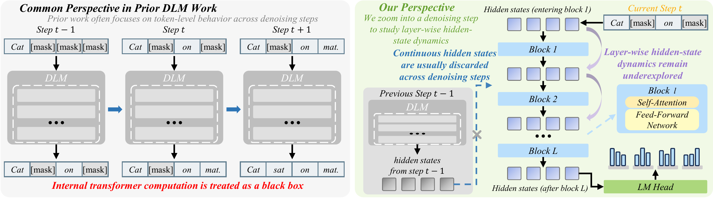

# On the Importance of Hidden-State Refinement in Masked Diffusion Language Models

<p align="center">
  <a href="https://arxiv.org/abs/2611.32416"></a>
  <a href="https://zhongzero.github.io/Recurrent-DLLM/"></a>
  <a href="https://github.com/zhongzero/Recurrent-DLLM"></a>
</p>



Cross-Step Recurrent Refinement (CSRR) carries the final transformer block’s hidden state from one denoising step to the next. After self-attention in block 1, the current state queries that detached memory through a separate set of Q/K/V/O projections. A scaled residual enters the block before its feed-forward network. The first step runs without memory, and the sampler keeps the original token update rule.

This release provides training and evaluation for **LLaDA-8B-Base and LLaDA-8B-Instruct**. The project website also presents the paper’s Dream experiments. To evaluate a trained CSRR model, first train an adapter with the commands below. The baseline can be evaluated directly with the public backbone.

## Repository structure

~~~text
Recurrent-DLLM/
├── scripts/                # Bash launchers for single- or multi-GPU runs
│   ├── train.sh
│   └── eval.sh
├── src/
│   ├── train.py            # Training CLI and recurrent trainer
│   ├── eval_model.py       # Benchmark generation and reasoning evaluation
│   ├── score_mbpp.py       # MBPP functional scoring
│   └── recurrent_dllm/     # LLaDA backbone, CSRR, sampler and data utilities
├── data/                   # Countdown evaluation puzzles
├── assets/                 # Paper figure used in this README
└── requirements.txt
~~~

Run the examples from the repository root. The launchers forward all arguments to the Python entry points. You can also use `python src/train.py --help` and `python src/eval_model.py --help` directly.

## Environment

Use Python 3.11 on Linux. The example installs PyTorch 2.5.1 for CUDA 12.1. Select the matching wheel for your GPU driver if needed. Training defaults to bfloat16. [PyTorch installation options](https://pytorch.org/get-started/previous-versions/)

~~~bash
git clone https://github.com/zhongzero/Recurrent-DLLM.git
cd Recurrent-DLLM
python3.11 -m venv .venv
source .venv/bin/activate
python -m pip install torch==2.5.1 --index-url https://download.pytorch.org/whl/cu121
python -m pip install -r requirements.txt
~~~

The scripts accept a Hugging Face model ID or a local directory containing the backbone and its tokenizer. The first online run downloads the selected backbone and datasets. [LLaDA Base](https://huggingface.co/GSAI-ML/LLaDA-8B-Base) · [LLaDA Instruct](https://huggingface.co/GSAI-ML/LLaDA-8B-Instruct)

## Evaluation

Start with the original LLaDA sampler on eight Countdown problems. Remove `--limit 8` for the full benchmark. Each output path names a new JSONL file.

~~~bash
bash scripts/eval.sh --baseline --model GSAI-ML/LLaDA-8B-Instruct \
  --task countdown --length 128 --steps 64 --limit 8 \
  --output results/baseline-countdown-smoke.jsonl
~~~

### Reasoning benchmarks

After training, use the adapter directory from a saved checkpoint. The script reads the backbone and layer choices from its metadata. Each JSONL row contains the prompt, generation, target, correctness and observed number of model calls. The terminal reports accuracy.

~~~bash
CKPT=runs/llada-instruct-joint/checkpoint-10000/adapter
for TASK in countdown gsm8k svamp; do
  bash scripts/eval.sh --checkpoint "$CKPT" --task "$TASK" \
    --length 128 --steps 64 --scale 1.0 --output "results/csrr-${TASK}.jsonl"
done
~~~

| Task | Evaluation set | Scoring |
| --- | --- | --- |
| Countdown | 256 puzzles in `data/countdown_cd3_test.jsonl` | Check the arithmetic result and use each supplied number exactly once |
| GSM8K | Official `main/test` split | Extract the numeric answer and compare with the reference |
| SVAMP | `ChilleD/SVAMP` test split | Extract the numeric answer and compare with the reference |

The paper uses block size 32, temperature 0.5 and low-confidence remasking. For 128 generated tokens use 64 or 128 steps. For 256 tokens use 128 or 256 steps. One step is one model forward evaluation (NFE). The example uses a **fixed** recurrent scale of 1.0. To compare with the paper’s main tables, run scales 0.5, 1.0, 1.5 and 2.0 for each CSRR setting and report the best accuracy. Keep the backbone, token budget and NFE identical for the baseline. For four GPUs, prefix the evaluation command with `NPROC_PER_NODE=4`.

### Code benchmarks

Generate one program per task. HumanEval and HumanEval+ use the same sample file. The official EvalPlus evaluator scores it against both test suites. Run the following from the repository root after setting `CKPT`. [EvalPlus evaluation guide](https://github.com/evalplus/evalplus)

~~~bash
bash scripts/eval.sh --checkpoint "$CKPT" --task humaneval \
  --length 256 --steps 128 --output results/humaneval.jsonl
docker run --rm -v "$PWD/results:/app" ganler/evalplus:latest \
  evalplus.evaluate --dataset humaneval --samples /app/humaneval.jsonl
~~~

For MBPP, use the sanitized test split and its supplied assertions. The following scoring command executes the generated programs. Run it in an isolated Linux environment. It requires a full prediction file with one program per test task. [MBPP dataset](https://huggingface.co/datasets/google-research-datasets/mbpp) · [Hugging Face code_eval](https://huggingface.co/spaces/evaluate-metric/code_eval/tree/main)

~~~bash
bash scripts/eval.sh --checkpoint "$CKPT" --task mbpp \
  --length 256 --steps 128 --output results/mbpp.jsonl
python -m pip install evaluate==0.4.3
HF_ALLOW_CODE_EVAL=1 python src/score_mbpp.py results/mbpp.jsonl
~~~

## Training

Train with consecutive denoising passes on the math subset of s1K. The original preprocessing filters on `cot_type`, extracts the boxed answer from the attempt, applies the tokenizer’s chat template and keeps examples with at least 32 response tokens. Each segment has two supervised forward passes. The collator selects a target block, and the trainer averages cross entropy over the two passes, replacing one selected mask with its prediction between them. A new segment starts with empty recurrent memory. [s1K dataset](https://huggingface.co/datasets/simplescaling/s1K)

- `joint` trains the four CSRR projections together with LoRA adapters on the backbone’s Q/K/V projections.
- `module-only` freezes the backbone and trains only the four CSRR projections.

~~~bash
bash scripts/train.sh --model GSAI-ML/LLaDA-8B-Instruct --mode joint \
  --output runs/llada-instruct-joint

bash scripts/train.sh --model GSAI-ML/LLaDA-8B-Instruct --mode module-only \
  --output runs/llada-instruct-module-only
~~~

The single-device defaults are batch size 4, sequence length 1,024, target block length 512, learning rate `1e-5`, weight decay 0.1 and gradient clipping at 1.0. The recurrent scale is sampled from {0.5, 1.0, 1.5, 2.0}. Joint training uses LoRA rank 128, alpha 256 and dropout 0.05. In this implementation the new projections start as copies of their backbone counterparts and are then optimized separately. Source and injection blocks default to the last and first blocks and can be selected with `--source-layer` and `--target-layer`.

For four GPUs, the following command keeps the effective batch size at four. Each worker holds one model replica. On a single GPU, use `--batch-size 1 --accumulation 4` for the same effective batch size.

~~~bash
NPROC_PER_NODE=4 bash scripts/train.sh --mode joint \
  --batch-size 1 --output runs/llada-instruct-joint-ddp
~~~

By default, each `checkpoint-N/` stores the optimizer, scheduler, RNG and trainer state for resuming. Its `adapter/` subdirectory contains the trainable weights and backbone metadata used by `src/eval_model.py`. Checkpoints are saved every 2,000 updates and at the final step. To resume, retain the original model, training mode, effective batch size and output directory.

~~~bash
bash scripts/train.sh --mode joint --output runs/llada-instruct-joint \
  --resume-from-checkpoint runs/llada-instruct-joint/checkpoint-2000
~~~

## Acknowledgments

The model and sampler build on LLaDA and Fast-dLLM. The supervised denoising and reasoning evaluation code build on d1. Model weights and benchmark data retain their upstream terms. [LLaDA](https://github.com/ML-GSAI/LLaDA) · [Fast-dLLM](https://github.com/NVlabs/Fast-dLLM) · [d1](https://github.com/dllm-reasoning/d1)

## 🖊️ Citation

If you use this work in your research, please cite our paper.

```bibtex
@misc{zhong2026importancehiddenstaterefinementmasked,
  title={On the Importance of Hidden-State Refinement in Masked Diffusion Language Models},
  author={Linhao Zhong and Bozhen Fang and Xuehao Wang and Zekai Luo and Liyang Li and Hourong Li and Chenchen Jing and Hao Chen},
  year={2026},
  eprint={2611.32416},
  archivePrefix={arXiv},
  primaryClass={cs.CL},
  url={https://arxiv.org/abs/2611.32416},
}
```
